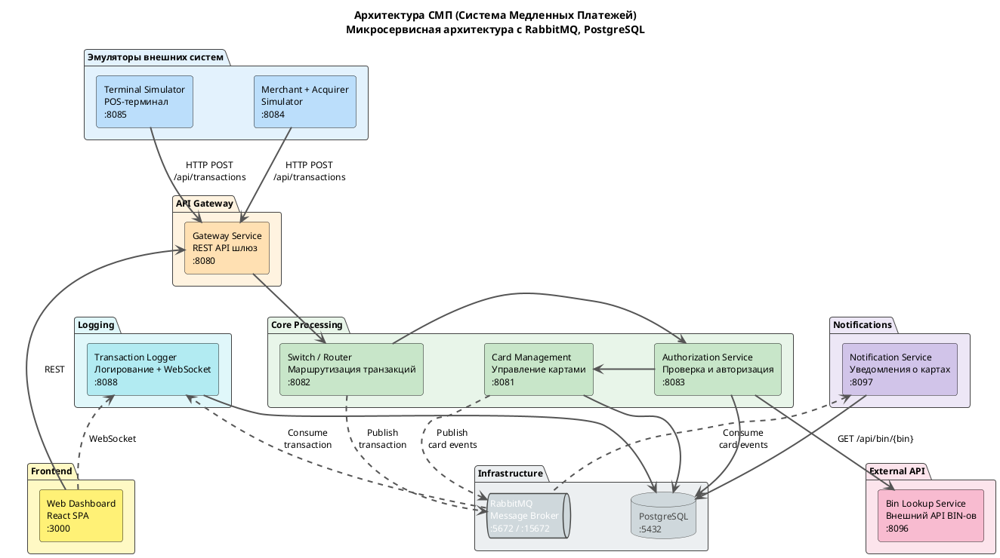

# Диаграммы СМП

## A1. Context

```plantuml

title Контекст — СМП и внешние системы

skinparam componentStyle rectangle
skinparam ArrowColor DimGray

actor "POS-терминал\nTerminal Simulator :8085" as TERM
actor "Мерчант + Эквайрер\nMerchant Simulator :8084" as MERCH
actor "Оператор дашборда" as OPS

rectangle "Внешний BIN Lookup :8096" as BIN #Pink

rectangle "СМП" as SMP #LightYellow {
    rectangle "API Gateway :8080" as GW #Orange
    rectangle "Web Dashboard :3000" as WEB #Yellow
    rectangle "Core Processing\n(Switch · Authorization · Card Management)" as CORE #LightGreen
}

TERM --> GW : HTTP POST /api/transactions
MERCH --> GW : HTTP POST /api/transactions
OPS --> WEB : HTTPS REST / WebSocket
GW --> CORE
WEB --> CORE
CORE --> BIN : HTTP GET /api/bin/{bin}
```

## A2. Container



## A3. Component

```plantuml
title Компоненты — Authorization и Card-Management

skinparam componentStyle rectangle
skinparam ArrowColor DimGray

package "Authorization :8083" as AUTH #LightYellow {
    [AuthControllerImpl] as AC
    [AuthServiceImpl] as AS
    [CardManagementClientImpl] as CMC
    [BinLookupClient] as BLC
    [LimitUsageRepository] as LUR
    [AuthorizationEventNotifierImpl] as AEN
    [AuthorizationLogEventListenerImpl] as ALE
}

package "Card-Management :8081" as CMS #Lavender {
    [CardController\n@RestController] as CC
    [CardServiceImpl] as CS
    [CardRepository\nReservationRepository] as REPO
    [CardEventNotifierImpl] AS CEN
    [OutboxProcessor\n@Scheduled] as OP
    [OutboxEventProcessorImpl] as OEP
    [OutboxRepository\nJDBC] as OBR
}

rectangle "BIN Lookup :8096" as BIN #LightPink
queue "RabbitMQ\nsmp.card-events" as RMQ #Gray

AC --> AS
AS --> CMC : getCard(pan)
AS --> BLC : getIssuerId(pan)
AS --> LUR : generateRnn()/checkAndUpdateUsage
AS --> AEN : notify(event)
CMC --> AEN : notify(event)
AEN --> ALE : onEvent(event)
BLC --> BIN : /api/bin/{bin}\nHTTP
CMC --> CC : getCard(pan)\n/api/cards/{pan}\nHTTP
CC --> CS
CS --> REPO
CS --> CEN : notifyListeners
CEN --> OEP : save
OBR ..> OP : findPending
OP --> OEP : processSingleEvent
OEP --> OBR : save
OEP ..> RMQ 

```

## A4. Sequence

```plantuml
title Путь транзакции — happy path

skinparam ArrowColor DimGray

actor "Terminal Simulator" as T
participant "Gateway" as GW
participant "Switch" as SW
participant "Authorization" as AUTH
participant "Card Management" as CMS
participant "Bin Lookup" as BIN
participant "RabbitMQ" as RMQ
participant "Logger" as LOG
participant "Notification Service" as NS

T->>GW: POST /api/transactions (auth request)
GW->>GW: validate request
GW->>SW: forward transaction
SW->>SW: extract BIN, route to issuer
SW->>AUTH: POST /api/internal/authorize (AuthorizationRequest + issuerId)
AUTH->>BIN: GET /api/bin/{bin} (enrich issuerId)
BIN-->>AUTH: BinLookupResponse {issuerId, ...}
AUTH->>CMS: GET /api/cards/{pan}
CMS-->>AUTH: Card {id, status, limits, ...}
AUTH->>AUTH: check status, expiry, limits, balance
alt approved
    AUTH->>CMS: POST /api/cards/{pan}/reserve {amount, rrn}
    CMS-->>AUTH: OK
    CMS-->>RMQ: Publish card event (outbox)
    AUTH->>AUTH: generate RRN, authCode
    AUTH-->>SW: AuthResponse {approved, rrn, authCode}
else declined
    AUTH-->>SW: AuthResponse {declined, reason}
end
SW->>RMQ: Publish Transaction (async)
SW-->>GW: TransactionResponse
GW-->>T: HTTP 200 {approved|declined, ...}
RMQ-->>LOG: Consume Transaction
LOG->>LOG: Save to DB
RMQ-->>NS: Consume card event
NS->>NS: Save notification
```

```plantuml
title Путь транзакции — declined (карта BLOCKED)

skinparam ArrowColor DimGray

actor "Terminal Simulator" as T
participant "Gateway" as GW
participant "Switch" as SW
participant "Authorization" as AUTH
participant "Card Management" as CMS
participant "RabbitMQ" as RMQ

T->>GW: POST /api/transactions (auth request)
GW->>SW: forward transaction
SW->>AUTH: POST /api/internal/authorize (AuthorizationRequest + issuerId)
AUTH->>CMS: GET /api/cards/{pan}
CMS-->>AUTH: Card {status: BLOCKED}
AUTH-->>SW: AuthResponse {declined, CARD_BLOCKED, 05}
SW->>RMQ: Publish Transaction (async)
SW-->>GW: TransactionResponse
GW-->>T: HTTP 200 {declined, responseCode 05}
```

```plantuml
title Путь транзакции — reversal (mti 0400)

skinparam ArrowColor DimGray

actor "Terminal Simulator" as T
participant "Gateway" as GW
participant "Switch" as SW
participant "Authorization" as AUTH
participant "Card Management" as CMS
participant "RabbitMQ" as RMQ

T->>GW: POST /api/transactions (auth request)
GW->>SW: forward transaction
SW->>AUTH: POST /api/internal/authorize (AuthorizationRequest + issuerId)
AUTH->>CMS: POST /api/cards/{pan}/reserve {amount, rrn}
CMS-->>AUTH: OK
AUTH-->>SW: AuthResponse {approved, rrn, authCode}
SW->>RMQ: Publish Transaction (async)
RMQ-->>SW: publisher confirm не получен за 2s
SW->>AUTH: POST /api/internal/rollback (reversal, mti=0400)
AUTH->>CMS: POST /api/cards/{pan}/rollback {amount, rrn}
CMS-->>AUTH: OK (ROLLED_BACK)
AUTH-->>SW: RollbackResponse {approved}
SW-->>GW: TransactionResponse {declined, responseCode 96}
GW-->>T: HTTP 200 {declined, responseCode 96}
```
## A5. RabbitMQ

```plantuml
title RabbitMQ — топология

package "Вариант A" as VA #LightYellow {
    rectangle "Switch\n(producer)" as SW
    rectangle "Exchange\nsmp.transactions\n(topic)" as EX1
    queue "transaction-log" as Q1
    rectangle "Exchange\nsmp.transactions.dlx" as DLX1
    queue "transaction-log-dlq" as DLQ1
    rectangle "TransactionLogListener.handleTransaction()\n(consumer)" as LOG
}

SW --> EX1 : LoggerClient.log()\nrk=transaction.log
EX1 --> Q1 : rk=transaction.log
Q1 --> LOG : @RabbitListener
Q1 ..> DLX1 : dead (3 attempts)
DLX1 --> DLQ1 : rk=transaction-log

package "Вариант C" as VC #Lavender {
    rectangle "Card Management\noutbox (producer)" as CMS
    rectangle "Exchange\nsmp.card-events\n(topic)" as EX2
    queue "card-notifications" as Q2
    rectangle "Exchange\nsmp.card-events.dlx" as DLX2
    queue "card-notifications-dlq" as DLQ2
    rectangle "CardEventListener.handleCardEvent() .\n(consumer)" as NS
}

CMS --> EX2 : OutboxEventProcessorImpl.processSingleEvent()\nrk=card.*
EX2 --> Q2 : rk=card.*
Q2 --> NS : @RabbitListener
Q2 ..> DLX2 : dead (3 attempts)
DLX2 --> DLQ2 : rk=card-notifications

```

## A6. State-transition

```plantuml

state "Card" as CS {
    [*] --> ACTIVE : createCard()
    ACTIVE --> BLOCKED : patch/bulkUpdate
    ACTIVE --> INACTIVE : patch/bulkUpdate
    ACTIVE --> EXPIRED : patch/bulkUpdate
    BLOCKED --> ACTIVE : patch/bulkUpdate
    BLOCKED --> EXPIRED : patch/bulkUpdate
    BLOCKED --> INACTIVE : patch/bulkUpdate
    INACTIVE --> ACTIVE : patch/bulkUpdate
    INACTIVE --> EXPIRED : patch/bulkUpdate
    INACTIVE --> BLOCKED : patch/bulkUpdate
    EXPIRED --> ACTIVE : patch/bulkUpdate
    EXPIRED --> BLOCKED : patch/bulkUpdate
    EXPIRED --> INACTIVE : patch/bulkUpdate
    ACTIVE --> DELETED : deleteCard()
    BLOCKED --> DELETED : deleteCard()
    INACTIVE --> DELETED : deleteCard()
    EXPIRED --> DELETED : deleteCard()
    DELETED --> [*]
}

state "Transaction" as TS {
    [*] --> APPROVED : authorize(): responseCode 00
    [*] --> DECLINED : authorize(): responseCode 05/51/54/61 14/96
    DECLINED --> [*]
    APPROVED --> [*]
}

```
